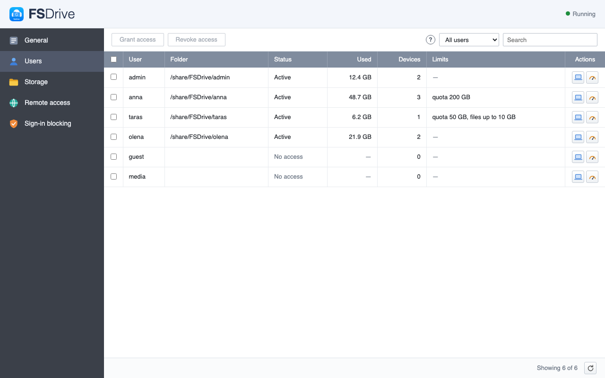

# FSDrive for QNAP (QTS, QuTS hero)

FSDrive turns your NAS into your own cloud. The server runs on the NAS, and the Mac client shows your files in Finder like iCloud Drive, downloading them on demand. On the NAS the files stay plain folders in a share or home folder you choose, so they remain reachable over SMB, in File Station and without FSDrive. Users sign in with their NAS accounts; the administrator chooses who may use FSDrive, sets quotas and file size limits, and can disconnect any device. Outside the local network devices connect through port forwarding, an HTTPS reverse proxy or an SSH gateway, encrypted with the server key. Settings open from the main menu.



This repository holds only the built package site, served at <https://romulas-12.github.io/fsdrive-packages-qnap/>; the source code is in
[FSDrive](https://github.com/Romulas-12/fsdrive). It is regenerated and replaced on every release; do not edit it by hand.

## Install

App Center → Settings → App Repository → Add, then paste the repository URL. In App Center → Settings → General, allow applications without a valid digital signature.

```
https://romulas-12.github.io/fsdrive-packages-qnap/repo.xml
```

Version 0.4.2. To install manually, download the package for your NAS:

| Arch | Package | SHA-256 |
|---|---|---|
| arm_64 | [FSDrive_0.4.2_arm_64.qpkg](https://romulas-12.github.io/fsdrive-packages-qnap/FSDrive_0.4.2_arm_64.qpkg) | `d08188f39e4d10f10d069cc787bedad55ba20eab4c7afbc6527adbb72baf6334` |

The package is not signed by the NAS vendor, so the app store shows a "no digital signature" notice.

If FSDrive was installed by hand before, App Center refuses to install it from the repository. Bind the installed package to the repository over SSH, then install; settings and files are kept:

```
setcfg FSDrive store $(printf %s 'https://romulas-12.github.io/fsdrive-packages-qnap/repo.xml' | md5sum | cut -c1-32) -f /etc/config/qpkg.conf
```

## Встановлення

App Center → Налаштування → «Репозиторій застосунків» → «Додати», вставте адресу репозиторію. У App Center → Налаштування → «Загальні» дозвольте застосунки без дійсного цифрового підпису.

License: AGPL-3.0.
